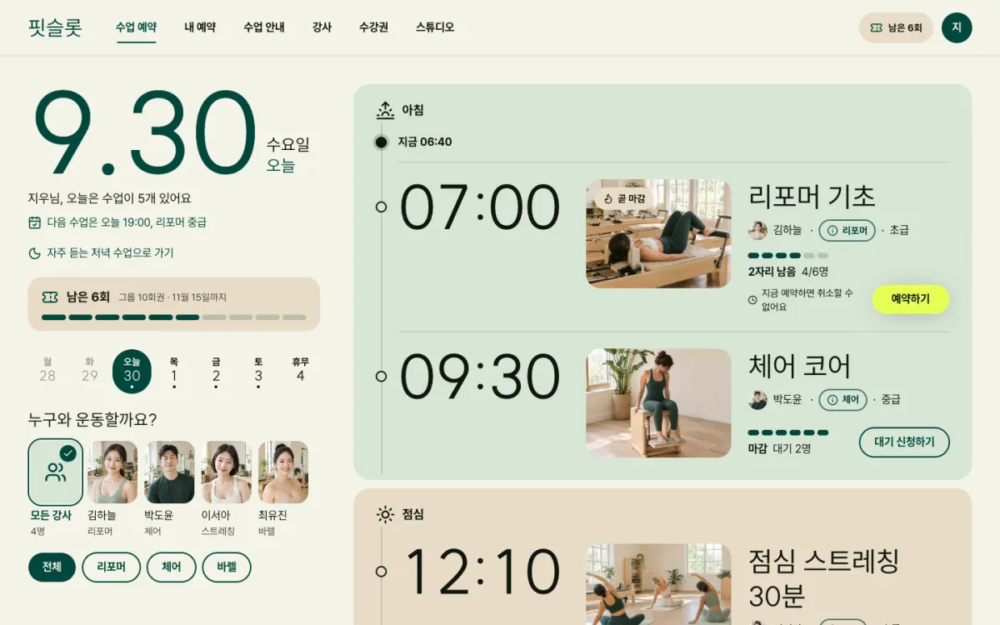
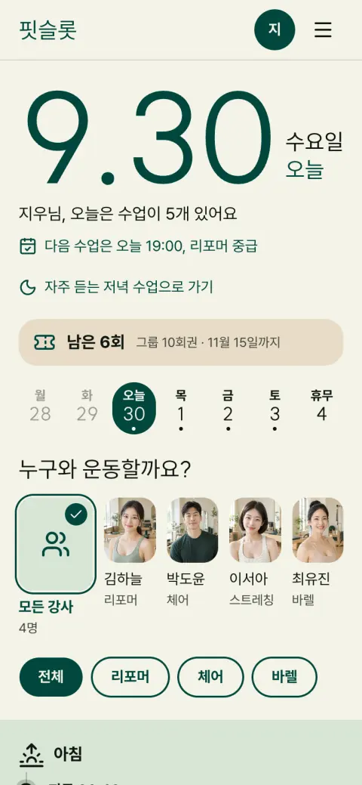

# 핏슬롯

동네 필라테스 스튜디오의 수업 예약 서비스예요. 이번 주 시간표에서 빈자리를 찾아 바로 예약하거나 취소하고, 수강권이 몇 번 남았는지와 언제까지 쓸 수 있는지 보여 줘요.



[프리셋 사이트 열기](https://prokit-web.vercel.app/pro-kit/fitslot/) · [프로킷 사이트에서 모든 페이지 보기](https://prokit-web.vercel.app/work/fitslot/)

| 항목 | 내용 |
|---|---|
| 페이지 | 20개: 수업 예약(홈), 내 예약, 수업 안내, 수업 상세 7개, 강사, 강사 상세 4명, 수강권, 프로필, 로그인, 가입하기, 스튜디오 안내 |
| 스타일 | Refero Styles의 [sweetgreen](https://styles.refero.design/style/d91841cf-c717-43ef-97a2-400778fa6e1a) |
| 대표 색 | 짙은 숲색 `#00473c` (예약 버튼만 라임색 `#e6ff55`) |
| 서체 | 제목 SUIT, 본문 Pretendard |
| AI로 그린 그림 | 18장 |
| 검사 | 버튼과 링크 153번 눌러 봄. 없는 페이지 0, 콘솔 오류 0 |

## 프리셋 팩으로 만들어 보기

<!-- b:preset-pack name=fitslot -->
작업 폴더 `~/projects`에서 연 에이전트에 이 프롬프트를 보내면 핏슬롯 프리셋과 같은 서비스를 만들어요. [프리셋 팩](https://github.com/roadkwon-ai/pro-kit-packs/releases/tag/pack-fitslot)의 화면 구성, 디자인, 예시 데이터, 그림을 그대로 써서 AI 그림을 새로 그리지 않아요. `[ ]` 안의 이름을 바꿔 같은 구성의 서비스를 만들어요. 팩을 써도 AI가 만들기 때문에 100% 똑같지는 않을 수 있어요.

```prompt
https://github.com/roadkwon-ai/pro-kit-ui 를 이 폴더에 받고, 그 안의 AGENTS.md대로 화면만 만들 프로젝트를 pro-kit-ui 옆에 [fitslot] 폴더로 만들어줘.
DB는 쓰지 않아. 없는 준비물은 설치해줘.
옆 폴더 pro-kit-ui의 packs/fitslot에 프리셋 팩을 받아줘.
그 팩대로 핏슬롯 프리셋과 똑같은 서비스를 만들 거야. 이름은 [핏슬롯].
팩의 README.md 순서대로 하고, 팩은 고치지 마. 이름을 바꿨으면 팩의 이름 대신 내가 정한 이름을 써.
디자인, 화면 구성, 그림은 팩에 있는 것을 써. 스타일 추천, 시안, 새 그림은 만들지 마.
모든 페이지의 기본 디자인은 팩의 스크린샷과 같게 만들어줘.
시스템·라이트·다크 모드 전환과 한국어·영어 전환을 모든 페이지의 기본 기능으로 넣어줘. 화면 문구는 같은 키를 가진 두 언어의 번역 사전에서 관리하고, 전환해도 현재 페이지와 입력을 유지해줘. 개발 화면과 HTML로 내보낸 결과에서 모든 페이지의 전환과 상태 유지를 실제로 확인해줘.
다 만들면 HTML 파일로 내보내줘.
```

> [!IMPORTANT]
> **프롬프트만 보내면 에이전트가 이 프리셋 팩을 자동으로 받아 설치해요. 따로 받지 않아도 돼요.**
>
> 직접 받으려면 [fitslot-pack.zip](https://github.com/roadkwon-ai/pro-kit-packs/releases/download/pack-fitslot/fitslot-pack.zip)(10.6MB, [릴리스](https://github.com/roadkwon-ai/pro-kit-packs/releases/tag/pack-fitslot))을 받고, 프롬프트 끝에 `프리셋 팩 zip은 [~/Downloads/fitslot-pack.zip]에 받아 뒀어.` 한 줄을 더하세요. 에이전트가 그 zip이 최신 판인지 확인하고, 옛 판이면 새로 받아요.
<!-- /b -->

<!-- b:preset-next-steps -->
에이전트를 아직 열지 않았으면 [1. 작업 폴더에서 에이전트 열기](README.md#1-작업-폴더에서-에이전트-열기)부터 하세요. 프롬프트를 보낸 다음에는 [3. 알려 준 한 줄로 이어 가기](README.md#3-알려-준-한-줄로-이어-가기)와 [4. 답하며 요청을 자세히 채우기](README.md#4-답하며-요청을-자세히-채우기)를 따라가면 돼요.
<!-- /b -->

<details>
<summary>막히면</summary>

<!-- b:trouble-pack name=fitslot -->
- **프리셋 팩을 못 찾는대요**: `프리셋 팩은 옆 폴더 pro-kit-ui의 packs/fitslot에 있어. 없으면 pro-kit-ui 폴더에서 node scripts/pack.mjs fitslot 명령으로 받아줘`라고 보내세요.
<!-- /b -->

</details>

## 프리셋 팩으로 나만의 서비스 만들기

<!-- b:preset-remix name=fitslot folder=yogaslot title="요가슬롯" changes="주제는 동네 요가 스튜디오, 대표 색은 진한 남색" topic="주제는 동네 요가 스튜디오 예약" -->
핏슬롯의 [프리셋 팩](https://github.com/roadkwon-ai/pro-kit-packs/releases/tag/pack-fitslot)을 바탕으로 이름, 색, 페이지, 주제를 바꿔 나만의 서비스를 만들어요. 화면 구성과 디자인이 정해져 있어서 처음부터 만들 때보다 빠르고, 맞지 않는 그림만 같은 화풍으로 다시 그려요.

```prompt
https://github.com/roadkwon-ai/pro-kit-ui 를 이 폴더에 받고, 그 안의 AGENTS.md대로 화면만 만들 프로젝트를 pro-kit-ui 옆에 [yogaslot] 폴더로 만들어줘.
DB는 쓰지 않아. 없는 준비물은 설치해줘.
옆 폴더 pro-kit-ui의 packs/fitslot에 프리셋 팩을 받아줘.
그 팩을 바탕으로 나만의 서비스를 만들 거야. 이름은 [요가슬롯].
바꿀 것: [주제는 동네 요가 스튜디오, 대표 색은 진한 남색]
팩의 README.md와 CUSTOMIZE.md를 보고, 바꾸는 것에 맞춰 다시 할 일만 해줘. 다시 그릴 그림은 팩의 prompts.json을 고쳐 같은 화풍으로 그려줘.
팩은 고치지 말고, 바꾸지 않는 것은 팩대로 해.
시스템·라이트·다크 모드 전환과 한국어·영어 전환을 모든 페이지의 기본 기능으로 넣어줘. 화면 문구는 같은 키를 가진 두 언어의 번역 사전에서 관리하고, 전환해도 현재 페이지와 입력을 유지해줘. 개발 화면과 HTML로 내보낸 결과에서 모든 페이지의 전환과 상태 유지를 실제로 확인해줘.
다 만들면 HTML 파일로 내보내줘.
```

`바꿀 것`에는 이렇게 적어요.
- 색이나 서체: `대표 색은 짙은 파랑, 제목 서체는 더 둥글게`
- 페이지: `[페이지 이름] 페이지는 빼줘` 또는 `[페이지 이름] 페이지를 더해줘`
- 주제: `주제는 동네 요가 스튜디오 예약`

무엇을 바꾸면 무엇을 다시 하는지는 팩의 `CUSTOMIZE.md`에 있어요. **그림을 다시 그리려면 이미지를 그릴 수 있는 에이전트가 필요해요**([이미지 그리기](../reference/costs-and-keys.md#이미지-그리기)). 그릴 수 없으면 원래 그림을 그대로 써요.

팩 zip을 미리 받아 두었다면 [프리셋 팩으로 만들어 보기](#프리셋-팩으로-만들어-보기)처럼 이 프롬프트 끝에도 zip 경로 한 줄을 더하세요.
<!-- /b -->

## 이 컨셉으로 처음부터 만들기

<!-- b:preset-scratch-intro -->
작업 폴더 `~/projects`에서 연 에이전트에 이 프롬프트를 그대로 보내면 **바로** 시작돼요. [가장 쉬운 방법](README.md#가장-쉬운-방법)의 프롬프트와 같고, `[ ]` 안만 이 프리셋의 폴더 이름과 컨셉이에요. 원하는 대로 바꿔도 돼요.
<!-- /b -->

<!-- b:screen-prompt folder=fitslot concept="동네 필라테스 스튜디오 회원이 이번 주 시간표에서 빈자리를 찾아 수업을 예약하고 취소하고, 남은 수강권을 확인하는 서비스" -->
```prompt
https://github.com/roadkwon-ai/pro-kit-ui 를 이 폴더에 받고, 그 안의 AGENTS.md대로 화면만 만들 프로젝트를 pro-kit-ui 옆에 [fitslot] 폴더로 만들어줘.
DB는 쓰지 않아. 없는 준비물은 설치해줘.
[동네 필라테스 스튜디오 회원이 이번 주 시간표에서 빈자리를 찾아 수업을 예약하고 취소하고, 남은 수강권을 확인하는 서비스]를 만들고 싶어.
필요한 화면을 모두 예시 데이터로 만들어줘. 로그인이나 저장 같은 기능은 빼고 화면만 만들어.
시스템·라이트·다크 모드 전환과 한국어·영어 전환을 모든 페이지의 기본 기능으로 넣어줘. 화면 문구는 같은 키를 가진 두 언어의 번역 사전에서 관리하고, 전환해도 현재 페이지와 입력을 유지해줘. 개발 화면과 HTML로 내보낸 결과에서 모든 페이지의 전환과 상태 유지를 실제로 확인해줘.
디자인 스타일은 서비스에 어울리는 걸로 추천해주고, 다 만들면 HTML 파일로 내보내줘.
```
<!-- /b -->

<!-- b:preset-scratch-note -->
**같은 컨셉이라도 이름, 스타일, 화면은 매번 다르게 나와요.** 프리셋에 가깝게 만들려면 [프리셋 팩으로 만들어 보기](#프리셋-팩으로-만들어-보기)를 쓰세요.
<!-- /b -->

<!-- b:preset-next-steps -->
에이전트를 아직 열지 않았으면 [1. 작업 폴더에서 에이전트 열기](README.md#1-작업-폴더에서-에이전트-열기)부터 하세요. 프롬프트를 보낸 다음에는 [3. 알려 준 한 줄로 이어 가기](README.md#3-알려-준-한-줄로-이어-가기)와 [4. 답하며 요청을 자세히 채우기](README.md#4-답하며-요청을-자세히-채우기)를 따라가면 돼요.
<!-- /b -->

## 시간과 비용

<!-- b:preset-time-line name=fitslot -->
위 "프리셋 팩으로 만들어 보기" 프롬프트로 만들 때 **한 번에 완성하면 약 1시간 55분\~3시간 50분(여러 번 고쳐 달라고 하면 약 5시간 45분까지)** 걸리고, 토큰은 최소 **약 250만**(캐시 포함 약 1.2억)이 들어요. 팩 없이 [이 컨셉으로 처음부터](#이-컨셉으로-처음부터-만들기) 만들 때는 한 번에 완성하면 약 2시간 45분\~5시간 30분(여러 번 고쳐 달라고 하면 약 8시간 15분까지) 걸리고, 토큰은 최소 약 360만이 들어요.
<!-- /b -->

<!-- b:revise-time-detail -->
<details>
<summary>자세히 보기: 고쳐 달라고 하면 왜 늘어날까요</summary>

| 과정 | 하는 일 | 더 드는 시간 |
|---|---|---|
| 고치기 | 요청을 읽고 고칠 곳을 찾아 고쳐요 | 약 2\~12분 |
| 검사 | 타입 검사, 포맷, 빌드 | 약 1\~3분 |
| 모든 페이지 다시 확인 | 고친 부품이 다른 페이지를 깨지 않았는지 봐요 | 13쪽 약 5분, 203쪽 약 6\~37분 |
| 리뷰 에이전트 | 크게 고쳤으면 고친 코드를 한 번 더 검토해요 | 약 4\~10분 |
| 마무리 | 기록, 검사, 커밋. 마지막에 한 번만 해요 | 약 1\~15분 |

**한 군데를 고치면 약 10분, 두 군데면 약 28\~43분이 더 들어요.** 마무리 검토(디자인 리뷰, 리뷰 에이전트, 모든 페이지 다시 확인)를 한 번 더 하면 2\~3시간이 더 들어요. 프리셋을 만들 때 잰 값이고, 내가 결과를 보고 확인하는 시간은 따로예요. [고쳐 달라고 할 때마다 더 드는 시간](../reference/process-and-time.md#고쳐-달라고-할-때마다-더-드는-시간)

</details>
<!-- /b -->

<!-- b:limit-line name=fitslot -->
Claude Pro · ChatGPT Plus(Codex): 가능 (5시간 한도에 약 1번 걸려요) · [5시간 한도란?](../reference/costs-and-keys.md#5시간-한도에-걸리면)
<!-- /b -->

<!-- b:cost-note -->
시간의 앞 숫자와 토큰은 순조롭게 한 번에 끝날 때의 최솟값이에요. 토큰도 시간처럼 쓰는 AI와 고쳐 달라는 횟수에 따라 2~3배까지 늘 수 있어요. [읽는 법](../reference/costs-and-keys.md#시간과-비용-읽는-법) · [실제로 걸린 시간 자세히](../reference/process-and-time.md)
<!-- /b -->

<details>
<summary>단계별 예상</summary>

<!-- b:preset-stage-intro -->
칸마다 시간 · 토큰 · API 요금 환산이고, 순조롭게 한 번에 끝날 때의 최솟값이에요. 합계의 시간에만 한 번에 완성할 때의 범위와 여러 번 고칠 때를 붙였어요.
<!-- /b -->

| 단계 | 프리셋 팩으로 | 처음부터(내 컨셉으로) |
|---|---|---|
| 준비: pro-kit-ui 받기, 프로젝트 만들기 | 5분 · 5.5만 · 1달러 | 5분 · 5.5만 · 1달러 |
| 기획: 서비스 질문, 이름, 사이트맵 | 5분 · 8.3만 · 2달러 | 10분 · 17만 · 3달러 |
| 디자인: DESIGN.md (처음부터는 스타일 추천 1\~3위 포함) | 5분 · 11만 · 2달러 | 8분 · 19만 · 4달러 |
| 화면 구성 | 팩의 스크린샷을 따라요 | 시안 3장 10분 · 17만 · 3달러 |
| 그림 18장 | 팩에서 받기 1분 | 9분 · 30만 · 6달러 |
| 첫 화면 | 10분 · 22만 · 4달러 | 15분 · 33만 · 6달러 |
| 나머지 페이지 19개 | 1시간 16분 · 165만 · 30달러 | 1시간 35분 · 210만 · 38달러 |
| 검사와 디자인 리뷰 | 11분 · 33만 · 6달러 | 11분 · 33만 · 6달러 |
| HTML 내보내기 | 2분 · 2.8만 · 1달러 미만 | 2분 · 2.8만 · 1달러 미만 |
| (선택) GitHub Pages 배포 | 5분 · 5.5만 · 1달러 | 5분 · 5.5만 · 1달러 |
| 합계(배포 빼고) | 약 1시간 55분\~3시간 50분 (여러 번 고치면 약 5시간 45분까지) · 약 250만(캐시 포함 약 1.2억) · 약 45달러 | 약 2시간 45분\~5시간 30분 (여러 번 고치면 약 8시간 15분까지) · 약 360만(캐시 포함 약 1.8억) · 약 65달러 |

<!-- b:preset-cost-detail -->
프리셋 팩으로 나만의 서비스를 만들면 다시 그리는 그림 장당 약 30초, 약 1.7만 토큰이 더 들어요. 주제를 바꾸면 기획에 5분, 약 8.3만 토큰이 더 들어요.

모두 실제로 잰 단위값으로 어림한 예상이에요. 시안과 AI 그림을 OpenAI API 키로 그리면 이미지 요금이 따로 들어요. ChatGPT 요금제로 그리면 그 사용량 안이에요.
<!-- /b -->

</details>

<details>
<summary>만든 사람이 실제로 쓴 값</summary>

<!-- b:preset-actual-line name=fitslot -->
핏슬롯 프리셋을 만들 때는 첫 화면 리디자인과 모든 페이지로 넓히기에 약 2시간 25분, 약 550만 토큰(캐시 포함 약 2.8억, API 요금 환산 약 100달러)이 들었어요. **사이트에 실으려고 다시 디자인하고 다듬은 값이라 위 예상보다 커요.** 버린 첫 초안과 나중의 문구 바꾸기는 넣지 않았어요.
<!-- /b -->

</details>

## 실제로 거친 과정

핏슬롯은 한 번에 나오지 않았어요. 결과를 보고 몇 번 다시 요청했어요.

| 단계 | 한 일 | 결과 |
|---|---|---|
| 1. 기획 | 서비스 설명(`PRODUCT.md`)과 첫 화면·두 번째 화면 설계만 미리 적었어요. 스타일과 색은 적지 않았어요 | 이름은 핏슬롯 |
| 2. 첫 판 | 추천 후보(토스, 쏘카, 당근)와 직접 정하기 중 3위 당근을 고르고 대표 색을 `#0F766E`로 정했어요 | 디자인 리뷰 25/40 |
| 3. 리디자인 | "표 같은 목록뿐이라 스튜디오 분위기가 없고, 글자가 작아"라고 [다시 요청](refine.md#스타일과-색)했어요. 추천 1\~3위(sweetgreen, Oakâme, MasterClass) 중 1위 sweetgreen, 대표 색은 원본 짙은 숲색 그대로. 시안 3장 중 C(시간 기둥)를 고르고, 시안에서 틀린 곳(아바타 글자, 19:00 수업의 난이도, 라임색을 쓴 곳)은 고치게 했어요 | 리디자인에 49분 |
| 4. 넓히기 | 첫 화면 하나를 모든 페이지를 갖춘 사이트로 넓혔어요. 이름은 그대로 두었어요. 예약 확인 창, 대기 신청, 예약 취소 확인, 수강권 구매(상품, 결제 요약, 완료), 캘린더 파일 내려받기가 동작해요 | 페이지 20개 |
| 5. 마무리 | 링크·버튼 검사, 디자인 리뷰, 다듬기. 바렐 플로우 사진의 다리가 이상하다고 짚어 줘서, 자세가 어색한 사진을 고치고 같은 조건으로 수업·강사·스튜디오 사진까지 모두 16장을 [다시 만들었어요](refine.md#사진-이미지를-그릴-수-있을-때) | 디자인 리뷰 28/40 |



